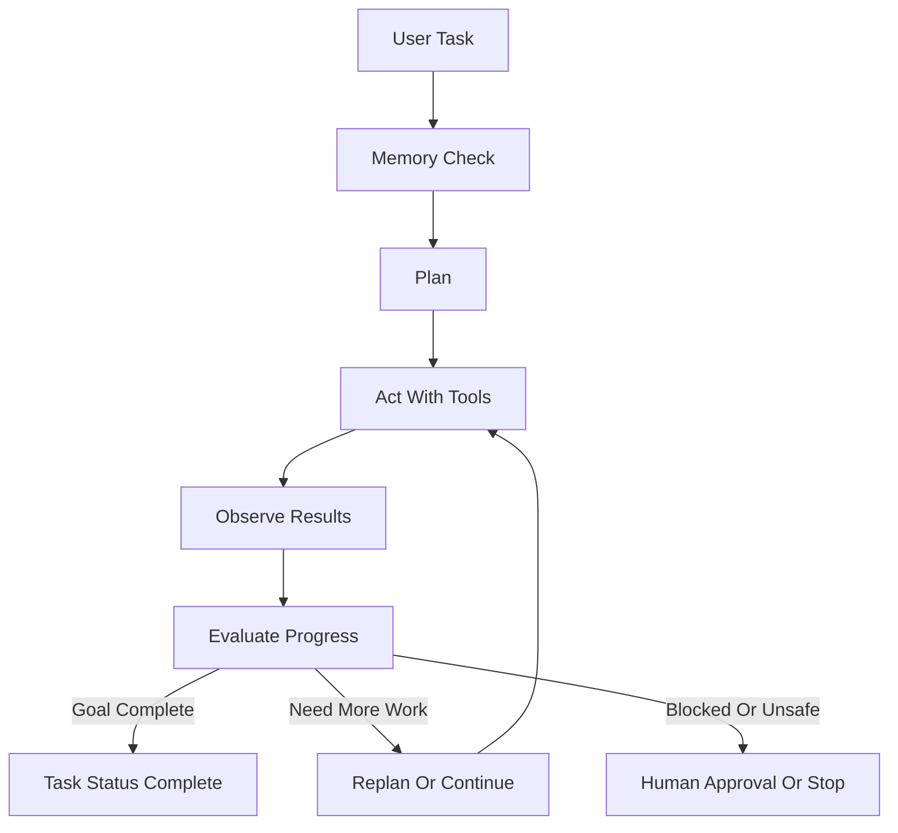

# Agent Loop Reference Kit

This folder is a portable knowledge base and reference implementation for building autonomous agent loops.

It is designed to be copied into another project as a reference package. It combines ideas from the Designing Multi-Agent Systems book/codebase and personal Obsidian agent learning notes.

## What Is Included

- Agent architecture handbook in `docs/` (01-15)
- Minimal streaming agent loop in `src/agent_loop_ref/`
- Lightweight reference modules for messages, context, tools, memory, hooks, and termination
- Enterprise role prompts in `prompts/roles/`
- JSON Schema templates in `schemas/`
- SWE agent workflow prompts and memory templates
- Runnable examples and offline smoke test
- License and attribution notes

## Reading Paths

### Path A: Basic Agent Loop (start here)

1. `docs/01-core-handbook.md` — core concepts
2. `docs/05-autonomous-loop-blueprint.md` — autonomous loop design
3. `docs/08-how-to-design-an-agent.md` — agent design checklist
4. `examples/01_minimal_streaming_agent.py` — run minimal loop

### Path B: Enterprise Multi-Agent System

1. `docs/10-enterprise-agent-system.md` — enterprise architecture
2. `docs/09-role-prompt-patterns.md` — role prompt patterns
3. `prompts/roles/` — copy role prompts
4. `schemas/` — JSON Schema contracts
5. `docs/14-production-readiness-checklist.md` — pre-launch checklist

### Path C: Memory, Orchestration, and Evals

1. `docs/12-memory-rag-state.md` — memory engineering
2. `docs/06-orchestration-patterns.md` + `docs/11-orchestration-reliability.md`
3. `docs/13-runtime-harness.md` — runtime harness
4. `docs/15-evals-system.md` — evaluation system

### Path D: Copy Into Another Project

1. `docs/16-copy-to-new-project-manual.md` — operation manual
2. `prompts/copy_kit_to_project_prompt.md` — prompt for an AI coding assistant
3. `memory_template/project_context.md` — fill target project context
4. `docs/14-production-readiness-checklist.md` — safety checklist

## Recommended Use

1. Copy `agent-loop-reference-kit/` into a target project.
2. Choose a reading path above based on your goal.
3. If migrating into another project, start with `prompts/copy_kit_to_project_prompt.md`.
4. Start from `examples/01_minimal_streaming_agent.py` for code.
5. Adapt `prompts/` and `memory_template/` to your project.
6. Keep `LICENSES/`, `NOTICE.md`, and `THIRD_PARTY_NOTICES.md`.

## Core Loop

## Important Boundary

This kit is a reference package, not a production-ready framework. Review licenses, safety controls, model settings, and tool permissions before use.
