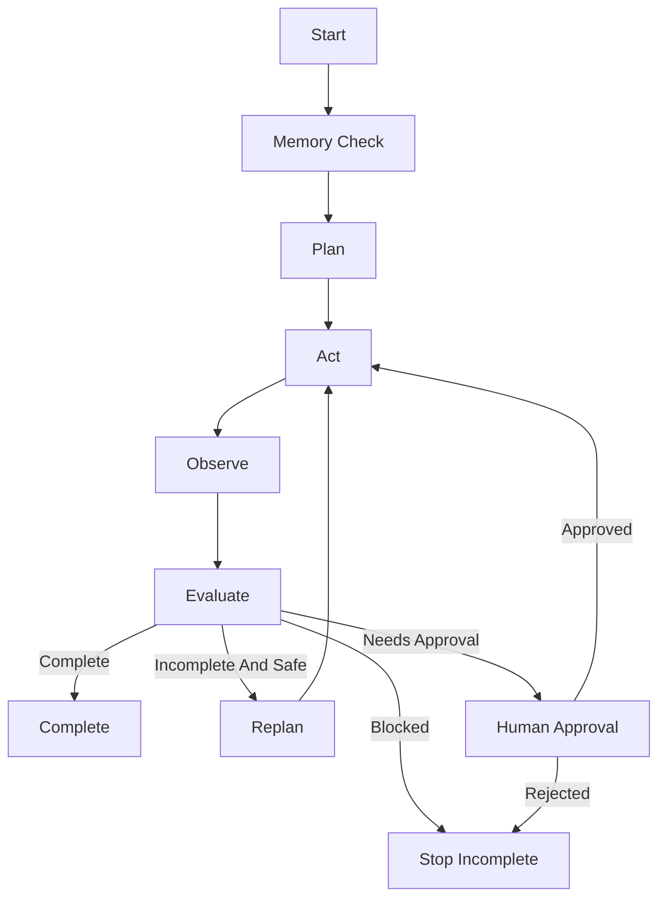

# 自主 Loop 蓝图

自主 loop 的目标不是让模型“随便循环”，而是让模型在受控状态机中持续推进任务。

## 推荐状态机



## Phase 1: Memory Check

Agent 每次开始前先查：

- `project_context.md`
- `current_task.md`
- `patterns/`
- `decisions/`

目的不是扩大上下文，而是避免重复踩坑和丢失项目约束。

## Phase 2: Plan

计划应包含：

- 任务拆解
- 每步的验证方式
- 风险点
- 需要审批的动作

计划可以由 LLM 生成，但最好写入 `current_task.md` 或显式状态对象。

## Phase 3: Act

每轮行动只做有限数量的工具调用。不要让单轮行动过大，否则观察和错误恢复会变差。

对代码任务，常见工具顺序是：

1. 读文件和搜索。
2. 小范围编辑。
3. 运行局部验证。
4. 更新 todo 和决策日志。

## Phase 4: Observe

观察不仅是拿到工具结果，还要判断结果是否可信：

- 命令是否成功。
- 文件是否真的改了。
- 测试是否覆盖目标。
- 错误是否可恢复。

## Phase 5: Evaluate

评估可以由确定性代码、LLM judge 或二者结合完成。

基础评估问题：

- 当前目标是否完成。
- 哪些需求已有证据。
- 哪些需求仍缺证据。
- 是否需要重试、重规划或停止。

## Phase 6: Replan Or Finish

如果未完成但仍安全，注入一条新的 user message 让 agent 继续：

```text
You are not done yet. Review the remaining requirements, update the plan, and continue.
```

如果完成，要求 agent 调用 `task_status(status="complete")`。如果阻塞，调用 `task_status(status="incomplete")`。

## 实现建议

先实现单 agent 自主 loop，再做多 agent。多 agent 不是自主性的前提，稳定的状态机和终止条件才是。

