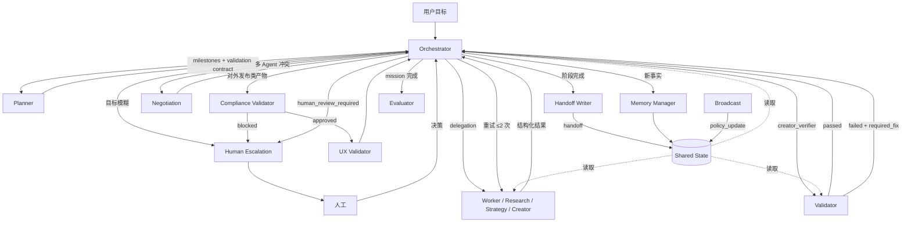

# 通用 Agent 系统架构规范

本目录是一套**不绑定具体业务**的多 Agent 系统设计规范，作为项目内可复用的模板库。落地任何具体业务（如剪辑流水线 Agent 化、内容生产流程）时，从这里实例化，替换假设清单中的默认值即可。

文件结构：

- `README.md`（本文件）：总体架构、默认假设、调用流程、代码硬控制、人工审核门、MVP、上线风险清单。
- `schemas.md`：message schema、handoff schema、shared state schema、validation contract。
- `agents.md`：通用基座 prompt、能力标签映射、15 个 Agent 的完整规格（职责、输入输出 JSON、system prompt、tools、失败处理、测试用例）。
- `extensibility.md`：拓展性机制——Agent/Tool 注册表、能力路由、prompt 三层结构、版本化规则、运行时适配层、扩展点操作清单。
- `instantiation-template.md`：domain profile 模板——落地新业务时唯一需要填写的配置，含实例化步骤清单和示例。

## 1. 默认假设（实例化时必须逐条确认或替换）

| # | 假设 | 默认值 |
|---|------|--------|
| A1 | 运行环境 | 单进程编排运行时（如 Python asyncio / Node），Agent 是逻辑角色而非独立服务 |
| A2 | 模型来源 | 通过统一的模型网关调用（可配置本地 Ollama 或 API 模型），每个 Agent 可指定不同模型 |
| A3 | 消息传输 | 进程内消息总线 + 本地 JSON 持久化；不假设 MQ/Kafka |
| A4 | 状态存储 | shared state 存本地 JSON/SQLite，单 mission 单写者（Orchestrator） |
| A5 | 重试策略 | 每个任务最多重试 2 次，第 3 次失败升级人工 |
| A6 | 超时 | 单个 Agent 调用默认 120s 超时，整个 mission 默认 30min 预算 |
| A7 | 成本预算 | 单 mission 默认 token/调用次数上限，超限暂停并升级 |
| A8 | 高风险动作 | 任何对外部世界产生不可逆影响的动作（发布、发送、删除、支付）默认需要人工审核 |
| A9 | 验证独立性 | Validator 与 Creator 使用不同的上下文（不共享 Creator 的推理过程），允许不同模型 |
| A10 | 数据边界 | Agent 只能通过声明的 tools 访问数据，不允许自由读写文件系统 |

## 2. 系统总体架构

系统分五层：

1. **入口层**：接收用户目标，创建 mission，写入 shared state。
2. **编排层**：Orchestrator（唯一决策中枢）+ Planner（规划）+ Negotiation（冲突仲裁）。
3. **执行层**：Worker / Research / Strategy / Creator，只做被分配的单一任务。
4. **验证层**：Validator（通用验收）、Compliance Validator（安全合规）、UX Validator（体验）。所有产物必须至少过 Validator；对外发布的产物必须过 Compliance。
5. **支撑层**：Memory Manager（记忆）、Broadcast（全局策略）、Handoff Writer（交接）、Human Escalation（人工升级）、Evaluator（离线评估）。

核心原则：

- **创建者与验证者分离**：任何 Agent 不能验证自己的输出。
- **Orchestrator 不执行**：只分派、汇总、决策，不产出业务产物，不做高风险动作。
- **一切经过 shared state**：Agent 之间不直接对话，所有消息落库，可回放。
- **JSON 强约束**：每个 Agent 输出必须通过对应 JSON Schema 校验（代码层），校验失败按失败处理流程走，不进入下游。
- **注册表驱动**：核心运行时只认识 manifest 和 schema，不硬编码任何 Agent 名字；计划引用能力标签（如 `create.document`），运行时按注册表解析为具体 Agent（见 extensibility.md §1–§2）。
- **业务与角色分离**：system prompt 分基座/角色/业务三层，落地新业务只写 domain profile 和业务层 prompt，其余全部复用（见 extensibility.md §4、instantiation-template.md）。

## 3. Agent 清单

| Agent | 类型 | 一句话职责 | 详细规格 |
|-------|------|-----------|---------|
| Orchestrator | 编排 | 理解目标、拆任务、分派、汇总、决定是否升级人工 | agents.md §1 |
| Planner | 编排 | 目标拆成 milestone，生成验收标准和 validation contract | agents.md §2 |
| Worker | 执行 | 执行单一明确任务，调用授权工具 | agents.md §3 |
| Research | 执行 | 搜集信息，区分事实/推测/观点，标注来源 | agents.md §4 |
| Strategy | 执行 | 生成并比较候选策略，输出推荐 | agents.md §5 |
| Creator | 执行 | 生成候选产物（文案/代码/方案/报告） | agents.md §6 |
| Validator | 验证 | 按 validation contract 独立验收 | agents.md §7 |
| Compliance Validator | 验证 | 安全/隐私/合规/品牌风险拦截 | agents.md §8 |
| UX Validator | 验证 | 面向用户的清晰度/语气/打扰度检查 | agents.md §9 |
| Negotiation | 编排 | 汇总多方立场，按硬规则仲裁冲突 | agents.md §10 |
| Broadcast | 支撑 | 全局事件转成策略更新并要求回执 | agents.md §11 |
| Memory Manager | 支撑 | 决定什么信息存到哪类 memory、何时过期 | agents.md §12 |
| Handoff Writer | 支撑 | 生成结构化交接文档 | agents.md §13 |
| Human Escalation | 支撑 | 判断并组织人工介入 | agents.md §14 |
| Evaluator | 支撑 | 离线评估系统输出质量，沉淀测试案例 | agents.md §15 |

另有一个元模板：**Agent 生成器**（用于从业务目标推导出一套具体 Agent 系统），见 agents.md §0。

## 4. 调用流程图

关键路径规则（代码强制，见 §5）：

1. 执行层产物 → Validator 是必经路径，Orchestrator 无法跳过。
2. `output_type` 为对外发布类（message/document 发布态）必须追加 Compliance → UX 双验证。
3. Validator `failed` 两次后自动进入 Human Escalation，不再重试。
4. 每个 milestone 完成必须产出 handoff 记录，否则 mission 无法推进到下一 milestone。

## 5. 必须用代码硬控制的规则（不能只靠 prompt）

| 规则 | 实现方式 |
|------|---------|
| 输出 JSON Schema 校验 | 每个 Agent 输出用 JSON Schema 校验器验证，失败即任务失败，不进入下游 |
| 工具白名单 | 每个 Agent 的可用 tools 在运行时注册表中声明，调用未授权工具直接拒绝并记录 |
| 高风险动作门 | 发布/发送/删除/支付类 tool 在代码层要求 `human_approval_token`，无 token 调用直接失败 |
| Validator 必经 | 状态机层面：任务状态只能从 `executed` 经 `validated` 到 `accepted`，没有旁路 |
| 创建者≠验证者 | 运行时检查 validation request 的 target agent ≠ source agent |
| 重试上限 | 计数器在 shared state，代码判断 ≥3 次失败强制升级，Agent 无法重置 |
| 超时与预算 | 编排层计时器 + token 计数，超限暂停 mission |
| 不可变字段 | 业务关键字段（如时间轴 start/end、金额、ID）在交接时代码 diff 校验，被模型改写即拒绝 |
| memory 写权限 | 只有 Memory Manager 的输出能触发 memory 写入，且 long_term/global 写入需二次确认规则 |
| broadcast 过期 | `expires_at` 由代码强制生效，过期策略自动失效，不依赖 Agent 记得 |
| 审计日志 | 所有消息、工具调用、状态变更 append-only 落盘，Agent 无删除权限 |

## 6. 必须人工审核的动作

- 对外发布（发消息给真实用户、发布内容、提交 PR 到受保护分支）。
- 不可逆操作（删除数据、覆盖长期记忆中的高可信信息）。
- 花钱的操作（付费 API 大批量调用、广告投放）。
- Compliance Validator 标记 `risk_level: high|critical` 的任何产物。
- 同一任务重试 2 次仍失败。
- Orchestrator 判定 `missing_information` 非空且无法通过 Research 补齐。
- Negotiation 输出 `requires_human_review: true` 的冲突决策。

## 7. MVP 版本

第一版只实现 5 个角色 + 3 条硬规则，其余角色的职责由代码或人工临时承担：

**MVP 角色**：

1. Orchestrator（简化：不处理 negotiation/broadcast）
2. Planner
3. Creator（兼任 Worker/Research 的产出职责）
4. Validator（兼任 Compliance 的基本安全检查）
5. Handoff Writer

**MVP 硬规则**：

1. JSON Schema 校验 + 失败重试上限 2 次。
2. Creator ≠ Validator（不同调用上下文）。
3. 高风险 tool 一律要求人工审核 token。

**MVP 中由人工承担**：Human Escalation 的判断（Validator 失败即通知人）、Memory 管理（不做自动记忆）、Evaluator（人工看日志）。

**MVP 验收标准**：给定一个含 3 个 milestone 的目标，系统能完成 计划 → 执行 → 验证 → 交接 全链路，每一步的 JSON 消息落盘可回放，注入一个必失败任务能正确升级人工。

## 8. 上线风险清单

| 风险 | 等级 | 缓解措施 |
|------|------|---------|
| Validator 与 Creator 同模型同偏差，验证形同虚设 | 高 | Validator 换用不同模型或不同温度；validation contract 用可执行断言（代码可查）而非主观描述 |
| JSON 输出偶发格式错误导致链路中断 | 高 | 代码层 schema 校验 + 一次自动修复重试（把校验错误回喂）；仍失败按任务失败处理 |
| 上下文膨胀：shared state 全量喂给每个 Agent | 高 | 每个 Agent 只接收其输入 schema 声明的字段，由编排层裁剪 |
| Prompt 注入：Research 抓回的内容操纵下游 Agent | 高 | 外部内容标记为 untrusted data，禁止作为指令解析；高风险动作门兜底 |
| 死循环：Validator 反复 fail、Creator 反复重交 | 中 | 重试上限硬控制；失败两次的 required_fix 必须与上次不同，否则直接升级 |
| 成本失控 | 中 | mission 级 token/调用预算，超限暂停 |
| 记忆污染：错误结论进入 long_term | 中 | long_term/global 写入要求 confidence: high + 证据；提供 memory 回滚 |
| broadcast 策略冲突或过期未撤销 | 中 | 策略带版本与 expires_at，代码强制过期；冲突走 Negotiation |
| 人工审核成为瓶颈 | 中 | 审核队列带 urgency 分级；低风险类别可配置白名单自动通过并抽检 |
| 可观测性不足，出错无法定位 | 中 | append-only 审计日志 + mission 回放工具是 MVP 必备，不是可选项 |
| Agent 职责漂移（Worker 擅自扩大范围） | 低 | 工具白名单硬控制 + Validator 检查产出是否超出任务范围 |
