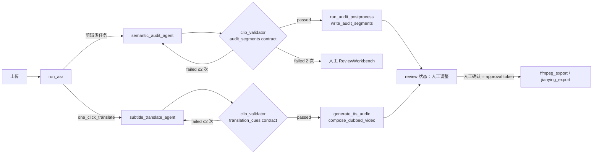

# GoldenClip 域 Agent 实例

本目录是 `docs/agent-architecture/`（通用模板，只读不改）在本项目上的**具体实例化**，按 `docs/agent-architecture/instantiation-template.md` 的约定填写。模板回答"Agent 系统应该长什么样"，本目录回答"GoldenClip 的 Agent 具体是什么"。

创作者写稿知识另存于 `creator_styles/`：共用方法见 [创作者风格分析](../../docs/creator-style-analysis.md)，`active.json` 指向当前创作者卡版本，每版同时保存 `card.md` 与 `evidence.json`。Lina 初版是用户报告摘要导入，逐条证据待补；数字人口播 AI 规划读取卡并在方向中保留快照，普通卖货视频不注入 Lina 卡。

数字人编辑页与 AI 执行阶段共用 `presenter_workflow.json` 指定的技能名称、调用时机与规则路径。结构阶段先起稿，文字阶段再润色；Lina 的结构技能与专属语气规则在 `creators.lina` 中覆盖通用配置。其他数字人使用通用技能与自己的档案。

## 目录结构

```
domains/goldenclip/
├── README.md                          # 本文件
├── profile.json                       # domain profile：业务目标、约束、启用能力、高风险动作、人工审核规则、黄金测试集
├── tools.json                         # 工具注册表：13 个工具，全部映射到现有 backend/services 实现
├── agents/                            # 5 个 Agent manifest
│   ├── clip_orchestrator.json         #   流水线编排
│   ├── semantic_audit_agent.json      #   语义审计
│   ├── golden_quote_agent.json        #   金句提取
│   ├── subtitle_translate_agent.json  #   字幕校准 + 翻译
│   └── clip_validator.json            #   产物验证
├── overlays/                          # 业务层 prompt（三层结构的第 3 层）
│   ├── orchestrator.md
│   ├── semantic_audit.md
│   ├── golden_quote.md
│   ├── subtitle_translate.md
│   └── validation.md
└── contracts/                         # 验收契约
    ├── audit_segments.contract.json   #   审计决策：9 条断言（6 code + 3 model）
    └── translation_cues.contract.json #   翻译 cue：8 条断言（5 code + 3 model）
```

## Agent 清单与现有代码的映射

这套 Agent 不是从零造轮子——每个 Agent 的"执行体"在后端已经存在，Agent 化的增量是：统一 manifest 声明、prompt 三层化、产物过独立验证、硬规则代码化。

| Agent | 能力 | 现有实现（执行体） | Agent 化的增量 |
|-------|------|-------------------|---------------|
| clip_orchestrator | orchestrate.clip_pipeline | `backend/main.py` 的后台任务调度 | 显式状态机 + delegation 消息落盘 + 审计/翻译产物必经 clip_validator |
| semantic_audit_agent | audit.segments | `backend/services/semantic_auditor.py` + `backend/prompts/*.md` | 场景 prompt 变为三层结构的注入层；输出先过 contract 再进后处理 |
| golden_quote_agent | extract.golden_quotes | `backend/services/golden_quote_extractor.py` | 输出结构化 + 强制引用 segment_ids，禁止改写原文 |
| subtitle_translate_agent | translate.cues | `backend/services/one_click_translate.py:_call_subtitle_llm` | 输出契约不变（id/calibrated_text/translated_text），验证从行内 raise 升级为 contract |
| clip_validator | validate.output | 部分散落在 `validate_stage_translated`、`parse_claude_response` 的行内校验 | 集中为 contract 断言：code 断言由运行时执行，model 断言独立模型评审 |

人工审核面 = 现有前端 `ReviewWorkbench`：任务进入 `review` 状态即停点，导出按钮即 approval token 入口，不需要新建审核 UI。

## 流水线（与 TaskStatus 状态机对应）



## 本域的硬规则（代码控制，prompt 只是重申）

1. **时间轴不可变**：segment 的 `id/start/end/text/words`、cue 的 `id/start/end/source_text` 在验证时做 diff，模型改写即整体拒绝（contract AS-03 / TC-03）。
2. **决策/id 全覆盖**：审计决策数 = 片段数、cue id 集合完全一致，缺一条整批重试（AS-02 / TC-02，对应现有 `calibrate_and_translate_cues` 的 missing 检查）。
3. **review 强制停点**：导出工具 `requires_human_approval: true`，approval token 来自前端导出请求，Orchestrator 无法自行导出。
4. **重试上限 2 次**：第 3 次失败升级人工，或走 rule_engine 降级（审计场景）。
5. **删除比例熔断**：delete 时长占比 > 50% 自动标记人工复核（AS-06）。
6. **转写文本 untrusted**：`read_asr_result` 的输出由运行时自动标记，防 prompt 注入（黄金测试 golden_prompt_injection）。

## 落地顺序建议（MVP → 完整）

1. **第一步（纯收益、零风险）**：把 `contracts/*.json` 里的 code 断言实现为后端函数，插到现有流程中——`semantic_auditor.parse_claude_response` 之后跑 audit contract，`calibrate_and_translate_cues` 之后跑 cue contract。不引入任何新 Agent 概念，直接提升现有流水线的可靠性。
2. **第二步**：把 `overlays/semantic_audit.md`、`overlays/subtitle_translate.md` 的硬约束合入现有 prompt 构建逻辑（`build_audit_prompt` / `_call_subtitle_llm` 的 system prompt），统一输出契约表述。
3. **第三步**：实现 clip_validator 的 model 断言——用与生成模型不同的模型（ApiConfig 中另配一个 validator 模型）对审计/翻译结果做独立评审，failed 时带 `required_fix` 重试一次。
4. **第四步**：把 `backend/main.py` 的后台任务调度重构为显式状态机 + 消息落盘（audit_log），实现 mission 回放。此时 clip_orchestrator 才成为真正的 Agent。

黄金测试集在 `profile.json` 的 `evaluation_goldens`，5 个用例覆盖：结巴修正、重说识别、cue id 完整性、prompt 注入、过度删除熔断。每次改 prompt 或换模型后必须全部通过。

## 与模板的差异声明

- 未启用模板中的 Research / Strategy / Negotiation / Broadcast / Memory Manager：本域流水线是确定性管道，没有开放式研究和多方冲突场景；用户风格记忆已有 `backend/data/user_style.md` + 学习流程（`learning_analyzer.py`）承担，暂不引入 Memory Manager。
- Handoff 由任务对象本身承担（`AuditSnapshot`、`TranslationVideo.status`、任务历史快照即交接记录），不单设 Handoff Writer。
- Evaluator 的职责由现有学习流程（LearningPage + `prompt_optimizer.py`）承担，黄金测试集是它的输入。
- 以上未启用项如果将来需要（比如接入选题策划类开放任务），按 `docs/agent-architecture/extensibility.md` §7 的扩展点清单加回，不改本目录已有文件。
